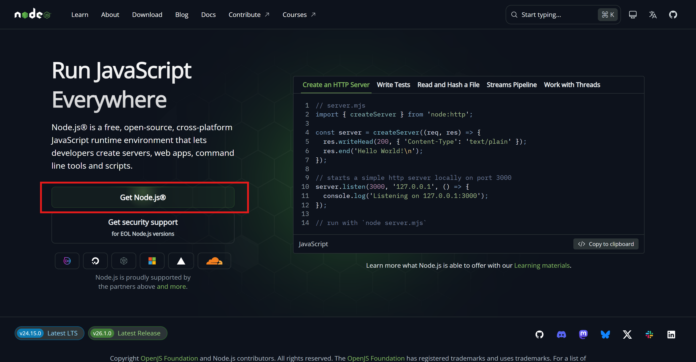
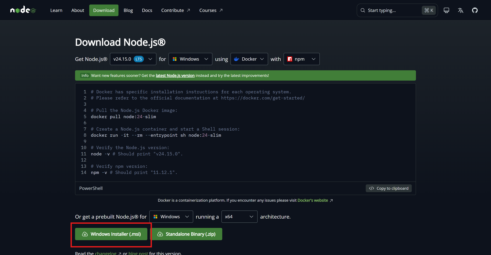
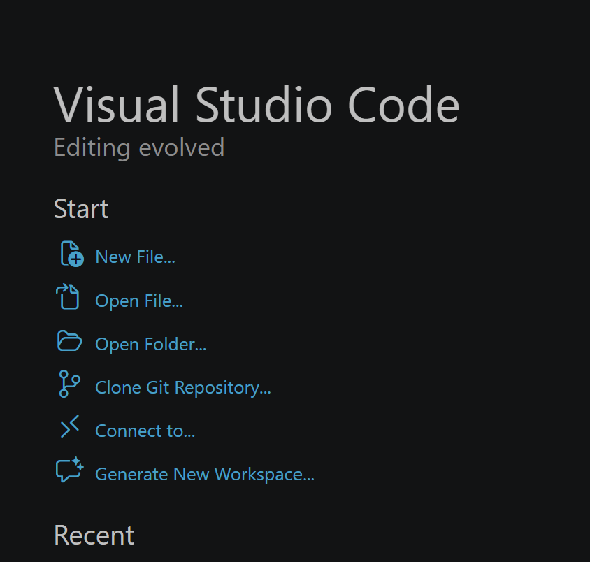

# Bài 3: Cài gì vào máy để bắt đầu vibecode?

- **1. Node.js — nền tảng để chạy code**
    
    **Node.js** là môi trường để máy bạn hiểu và chạy được JavaScript — ngôn ngữ mà hầu hết web app dùng.
    
    Bạn không cần biết Node là gì. Chỉ cần cài nó vào là xong.
    
    **Cài ở đâu:** [nodejs.org](https://nodejs.org/) 
    
    
    
    
    
    → tải bản **LTS** (cái có chữ "Recommended for most users")
    
    **Kiểm tra sau khi cài:** Mở Terminal (Mac) hoặc Command Prompt (Windows), gõ:
    
    ```powershell
    node -v
    ```
    
    Nếu ra số version kiểu `v20.x.x` là thành công.
    
    > **Lưu ý:** Chọn bản LTS, không chọn Current. Bản Current hay lỗi hơn với các tool khác.
    > 
- **2. VS Code — editor chính để viết code**
    
    **VS Code** (Visual Studio Code) là code editor phổ biến nhất thế giới, miễn phí, của Microsoft. Đây là nơi bạn sẽ mở project, đọc và chỉnh code trong suốt quá trình vibecode.
    
    **Cài ở đâu:** [code.visualstudio.com](https://code.visualstudio.com/) → tải về, cài theo mặc định.
    
    - **2.1 Các thanh làm việc khi dùng VSCode**
        - **2.1.1 Màn hình Welcome — nhìn thấy gì khi mở VS Code lần đầu**
            
            Khi mở VS Code lên, bạn sẽ thấy màn hình này. Không cần dùng hết — chỉ cần biết mấy cái thực sự dùng tới.
            
            
            
            ### **Phần Start — bên trái:**
            
            | Mục | Dùng không? | Để làm gì |
            | --- | --- | --- |
            | **New File...** | Ít dùng | Tạo một file mới lẻ — thường không cần khi vibecode |
            | **Open File...** | Ít dùng | Mở một file đơn lẻ — tránh dùng cách này |
            | **Open Folder...** | ✅ Dùng nhiều nhất | Mở cả thư mục project — đây là cách đúng |
            | **Clone Git Repository...** | ✅ Dùng khi cần | Kéo project từ GitHub về máy để chỉnh sửa — chỉ cần link repo là clone được, không cần tải zip hay bất kỳ file nào thủ công |
            | **Connect to...** | Không cần | Kết nối remote server — không liên quan lúc này |
            | **Generate New Workspace...** | Không cần | Tính năng nâng cao — bỏ qua |
            
            > **Thói quen đúng:** Mỗi lần mở VS Code → nhấn **Open Folder** → chọn thư mục project. Không mở file lẻ.
            > 
            
            ### **Phần Recent — bên trái dưới:**
            
            Danh sách các project bạn đã mở gần đây. Lần sau muốn mở lại project cũ — nhấn thẳng vào tên ở đây, không cần tìm lại trong máy. Nhấn vào tên là VS Code mở thẳng project đó.
            
        - **2.1.2 Thanh menu trên cùng — cần biết cái nào**
            
            Khi đã mở project, bạn sẽ thấy thanh menu chạy ngang trên cùng. Nhìn có vẻ nhiều nhưng khi vibecode chỉ dùng vài cái.
            
            ### **Các mục trên thanh menu:**
            
            | Mục | Dùng không? | Để làm gì |
            | --- | --- | --- |
            | **File** | ✅ Thỉnh thoảng | Mở folder, lưu file, đóng project |
            | **Edit** | Ít dùng | Copy, paste, undo — dùng phím tắt sẽ nhanh hơn |
            | **Selection** | Không cần | Chọn vùng code nâng cao — bỏ qua |
            | **View** | ✅ Thỉnh thoảng | Bật/tắt Terminal, Explorer, Extensions |
            | **Go** | Không cần | Nhảy đến dòng code — dùng khi đã quen hơn |
            | **Run** | Ít dùng | Chạy/debug code — vibecode thường dùng Terminal thay |
            | **Terminal** | ✅ Dùng nhiều | Mở Terminal tích hợp ngay trong VS Code |
            | **Help** | Không cần | Tài liệu và thông tin VS Code |
            
            ### **Phần giữa thanh — ô tên project:**
            
            Ô chữ ở giữa đang hiển thị tên project đang mở. Nhấn vào đây cũng có thể tìm file nhanh trong project bằng cách gõ tên file.
            
            > Phím tắt tìm file nhanh hơn: `Ctrl+P` (Windows) / `Cmd+P` (Mac) → gõ tên file cần mở.
            > 
            
            ### **Các icon bên phải:**
            
            | Icon | Để làm gì |
            | --- | --- |
            | Icon chat / comment | Mở GitHub Copilot hoặc AI chat đang cài |
            | **Update** (nút xanh) | VS Code đang có bản cập nhật — nhấn để cập nhật khi rảnh, không ảnh hưởng việc đang làm |
            | Các icon layout góc phải | Thay đổi cách chia màn hình — ít dùng |
            
            > **Thói quen dùng menu khi vibecode:** Gần như chỉ cần `Terminal` → `New Terminal` để mở terminal. Còn lại dùng phím tắt sẽ nhanh hơn nhiều.
            > 
            
            ### **3 phím tắt đáng nhớ nhất từ menu:**
            
            ```powershell
            Ctrl + `        Mở / đóng Terminal
            Ctrl + P        Tìm và mở file nhanh
            Ctrl + Shift + X    Mở Extensions
            ```
            
            Mac thay `Ctrl` bằng `Cmd`.
            
        - **2.1.3 Thanh icon bên trái — Activity Bar**
            
            Đây là thanh điều hướng chính của VS Code. Mỗi icon mở ra một panel khác nhau ở cột trái. Khi vibecode chỉ cần biết vài cái.
            
            ### **Từ trên xuống dưới:**
            
            | Icon | Tên | Dùng không? | Để làm gì |
            | --- | --- | --- | --- |
            | 📄 Icon file | **Explorer** | ✅ Dùng nhiều nhất | Xem cây thư mục project — mở file từ đây |
            | 🔍 Icon kính lúp | **Search** | ✅ Thỉnh thoảng | Tìm kiếm chữ trong toàn bộ project |
            | 🔀 Icon nhánh | **Source Control** | ✅ Dùng khi cần | Quản lý Git — xem file nào đã thay đổi |
            | 🐛 Icon chạy/debug | **Run & Debug** | Không cần | Debug code nâng cao — bỏ qua lúc này |
            | 🧩 Icon 4 ô vuông | **Extensions** | ✅ Dùng khi cài tool | Tìm và cài extension AI — có badge số `1` nghĩa là đang có extension cần cập nhật |
            
            ### **Phần dưới cùng:**
            
            | Icon | Để làm gì |
            | --- | --- |
            | 👤 Icon người | Tài khoản đang đăng nhập VS Code — đồng bộ settings |
            | ⚙️ Icon bánh răng | Settings và cấu hình VS Code — ít khi cần đụng |
            
            > **Badge số `1`** trên icon Extensions nghĩa là có extension đang chờ cập nhật. Nhấn vào → tìm extension đó → nhấn Update. Không ảnh hưởng việc đang làm nếu bỏ qua.
            > 
            
            ### **Thói quen khi vibecode — chỉ cần nhớ 3 icon:**
            
            ```powershell
            📄 Explorer        → mở file, xem cấu trúc project
            🧩 Extensions      → cài thêm tool AI
            ✳️ AI Extension    → chat với AI để viết / sửa code
            ```
            
            Còn lại nhấn vào khi nào cần thì biết — không cần nhớ hết ngay.
            
        - **2.1.4 Thanh dưới cùng — Status Bar**
            
            Thanh chạy ngang dưới đáy VS Code. Hiển thị toàn bộ trạng thái hiện tại của project và file đang mở — nhìn vào đây biết ngay mọi thứ đang ổn hay không.
            
            **Phần bên trái:**
            
            | Thành phần | Trong ảnh | Ý nghĩa |
            | --- | --- | --- |
            | `><` Icon |  | Trạng thái kết nối — local hay remote |
            | 🔀 **Tên nhánh Git** | `main` | Branch Git đang làm việc — khi vibecode thường là `main` |
            | 🔄 Icon sync | Icon vòng tròn | Đồng bộ Git — nhấn để pull/push nhanh |
            | ⊗ **Số lỗi** | `0` | Số lỗi trong code — **phải giữ ở 0** |
            | ⚠️ **Số cảnh báo** | `0` | Số warning trong code — cố giữ thấp nhất có thể |
            
            **Phần bên phải — thông tin file đang mở:**
            
            | Thành phần | Trong ảnh | Ý nghĩa |
            | --- | --- | --- |
            | 👤 **Git blame** | `ABC (5 months ago)` | Người cuối cùng sửa dòng code đang đứng — và sửa khi nào. Khi vibecode một mình thì thường là tên bạn |
            | **Ln, Col** | `Ln 11, Col 33` | Con trỏ đang đứng ở dòng 11, cột 33 — hữu ích khi AI báo lỗi ở dòng cụ thể |
            | **Spaces** | `Spaces: 2` | Kiểu indent đang dùng — 2 spaces là chuẩn cho hầu hết web project |
            | **Encoding** | `UTF-8` | Bảng mã ký tự — giữ nguyên UTF-8, không cần đổi |
            | **Line ending** | `CRLF` | Kiểu xuống dòng — `CRLF` là Windows, `LF` là Mac/Linux. Thường không cần đổi |
            | **Ngôn ngữ file** | `Markdown` | Loại file đang mở — VS Code tự nhận diện. Ảnh hưởng đến syntax highlight và gợi ý code |
            | Icon người + màn hình |  | Tài khoản đang kết nối |
            | **Go Live** | `Go Live` | Bật Live Server — xem web tĩnh trực tiếp trên trình duyệt |
            | 🔔 Icon chuông |  | Thông báo từ VS Code |
            
            > **Git blame** — ABC`(5 months ago)` nghĩa là dòng code con trỏ đang đứng được người dùng “ABC” sửa lần cuối cách đây 5 tháng. Khi AI sửa code và push lên, chỗ này sẽ hiện tên GitHub của bạn và thời gian vừa commit.
            > 
            
            **Quan trọng nhất cần nhìn khi vibecode:**
            
            ```powershell
            ⊗ 0  ⚠ 0           → code không có lỗi
            Ln XX, Col XX        → biết con trỏ đang ở đâu khi AI báo lỗi dòng cụ thể
            { } Tên ngôn ngữ     → biết file đang mở là loại gì
            ```
            
            **Khi số lỗi tăng lên khác 0:**
            
            Nhấn thẳng vào `⊗ số` → VS Code mở panel **Problems** liệt kê toàn bộ lỗi đang có, từng file, từng dòng. Copy nội dung lỗi đó → paste vào chat AI → nhờ sửa. Không cần tự đọc hiểu lỗi.
            
    - **2.2 Làm việc thực tế trong VS Code**
        - **2.2.1 Làm việc với Terminal trong VS Code**
            
            Không cần mở Terminal riêng bên ngoài. VS Code có Terminal tích hợp sẵn — mở ra là đang đứng đúng thư mục project, không cần `cd` thêm gì.
            
            **Mở Terminal:**
            
            ```powershell
            Ctrl + `        (Windows)
            Cmd + `         (Mac)
            ```
            
            Hoặc vào menu `Terminal` → `New Terminal`.
            
            ---
            
            ### Dùng pnpm thay cho npm — tại sao?
            
            Khi vibecode với AI, bạn sẽ thấy AI hay gõ lệnh bắt đầu bằng `npm`. Dùng được — nhưng nên đổi sang **pnpm** từ đầu.
            
            **Lý do thực tế:**
            
            |  | npm | pnpm |
            | --- | --- | --- |
            | Tốc độ cài package | Chậm hơn | Nhanh hơn đáng kể |
            | Dung lượng ổ cứng | Tốn — mỗi project copy riêng | Tiết kiệm — dùng chung một chỗ lưu |
            | Số project nhiều lên | Ổ cứng đầy nhanh | Không bị vấn đề này |
            | Dùng với Next.js, Vercel | Ổn | Ổn, Vercel hỗ trợ tốt |
            
            Nói đơn giản: `npm` giống như mỗi lần mua đồ là mua cả bộ mới. `pnpm` giống như mua một lần, dùng chung cho nhiều chỗ — nhanh hơn, đỡ tốn hơn.
            
            **Cài pnpm một lần duy nhất trong terminal:**
            
            ```powershell
            npm install -g pnpm
            ```
            
            Sau đó mọi lệnh `npm` đều thay bằng `pnpm` là xong.
            
            ---
            
            ### Các lệnh Terminal dùng nhiều nhất
            
            **Cài dependencies — chạy khi mở project mới về lần đầu:**
            
            ```powershell
            pnpm install
            ```
            
            Lệnh này đọc file `package.json` trong project và tự tải về tất cả thư viện cần thiết. Mỗi project chỉ cần chạy một lần, hoặc khi AI thêm package mới vào.
            
            ---
            
            ### **Chạy web trên máy để xem thử:**
            
            ```powershell
            pnpm run dev
            ```
            
            Sau lệnh này, mở trình duyệt vào `http://localhost:3000` để xem web đang chạy. Mỗi lần AI sửa code, trang tự cập nhật — không cần reload tay.
            
            ---
            
            ### **Build project để kiểm tra trước khi deploy:**
            
            ```
            pnpm run build
            ```
            
            Lệnh này đóng gói toàn bộ code thành bản production — giống như "xuất bản chính thức" trước khi đưa lên internet.
            
            Dùng khi nào:
            
            - Trước khi `git push` lên Vercel — để chắc chắn code không bị lỗi khi build
            - Khi Vercel báo lỗi deploy — chạy `build` trên máy trước để xem lỗi ở đâu, sửa xong rồi mới push
            
            > **Khác gì với `pnpm run dev`?** — `dev` chạy để xem thử trên máy, chấp nhận một số lỗi nhỏ vẫn chạy được. `build` thì nghiêm hơn — lỗi nhỏ nào cũng báo và dừng lại. Nếu `build` pass thì deploy lên Vercel gần như chắc chắn không lỗi.
            > 
            
            ---
            
            ### **Dừng server:**
            
            ```powershell
            Ctrl + C
            ```
            
            ---
            
            ### **Thêm một package mới vào project:**
            
            ```powershell
            pnpm add tên-package
            ```
            
            Khi AI bảo bạn cài thêm thư viện gì đó — lệnh này dùng để cài.
            
            ---
            
            ### **Xoá thư mục node_modules và cài lại từ đầu:**
            
            ```powershell
            rm -rf node_modules
            pnpm install
            ```
            
            Dùng khi project bị lỗi kỳ lạ không rõ nguyên nhân — xoá sạch rồi cài lại thường fix được.
            
            ---
            
            ### **Xem các script có thể chạy trong project:**
            
            ```powershell
            pnpm run
            ```
            
            Liệt kê tất cả lệnh mà project đó hỗ trợ — ngoài `dev` còn có thể có `build`, `lint`, `test`...
            
            ---
            
            ### Các lệnh Git dùng khi vibecode
            
            Sau khi AI sửa xong và bạn ưng kết quả, đẩy code lên GitHub:
            
            ```powershell
            git add .
            git commit -m "mô tả ngắn vừa làm gì"
            git push
            ```
            
            Ba lệnh này theo thứ tự, chạy lần lượt. Vercel sẽ tự nhận và deploy trong vài chục giây.
            
            > Phần `"mô tả ngắn"` viết gì cũng được — miễn nhớ lần đó sửa cái gì. Ví dụ: `"thêm form liên hệ"`, `"sửa màu nút header"`, `"cập nhật nội dung trang chủ"`.
            > 
            
            ---
            
            ### **Kéo code mới nhất từ GitHub về máy:**
            
            ```powershell
            git pull
            ```
            
            Dùng khi làm việc trên nhiều máy, hoặc khi có người khác cùng sửa project.
            
            ---
            
            ### Mở nhiều Terminal cùng lúc
            
            Khi vibecode thường cần chạy song song 2 terminal:
            
            - **Terminal 1:** chạy `pnpm run dev` — để server luôn bật
            - **Terminal 2:** gõ các lệnh git, pnpm add... — không làm gián đoạn server
            
            Nhấn icon `+` trong góc phải của panel Terminal để mở thêm tab mới.
            
            ---
            
            ### Tóm tắt lệnh hay dùng nhất
            
            ```powershell
            pnpm install          Cài dependencies lần đầu
            pnpm run dev          Chạy web trên máy
            pnpm add [tên]        Thêm package mới
            Ctrl + C              Dừng server
            
            git add .             Đánh dấu thay đổi
            git commit -m "..."   Lưu lại với ghi chú
            git push              Đẩy lên GitHub → Vercel tự deploy
            git pull              Kéo code mới nhất về máy
            ```
            
            > Thật ra, khi mình làm việc mình không cần nhớ tất cả, mình chỉ nhớ 3 lệnh đầu thôi, còn những lệnh khác nếu bạn ko dám chắc bạn cứ hỏi AI vì AI hiểu codebase hơn bạn và nó sẽ biết cần chạy lệnh gì tốt nhất.
            > 
        - **2.2.2 Panel Source Control — commit không cần gõ lệnh Git**
            
            Ngoài cách dùng lệnh `git add`, `git commit`, `git push` trong Terminal, VS Code có sẵn **Source Control** — giao diện trực quan để làm việc với Git, không cần nhớ lệnh.
            
            Mở bằng cách nhấn icon nhánh cây ở Activity Bar, hoặc `Ctrl+Shift+G` (Windows) / `Cmd+Shift+G` (Mac).
            
            ---
            
            ### Giao diện Source Control trông như thế nào
            
            #### **Phần CHANGES:**
            
            Khi AI sửa code, tất cả file bị thay đổi sẽ hiện ra ở đây. Nhấn vào từng file để xem cụ thể dòng nào bị sửa — chữ xanh là thêm vào, chữ đỏ là xoá đi.
            
            1. **Ô Message:**
            
            `Message (Ctrl+Enter to commit...)`
            
            Gõ mô tả ngắn vào đây — giống như phần `"mô tả ngắn"` trong lệnh `git commit -m`. Ví dụ: `"thêm form liên hệ"`, `"sửa màu nút header"`.
            
            Icon ✨ ở góc phải ô Message: nhấn vào để AI tự **tự động sinh commit message** dựa trên những gì vừa thay đổi — không cần tự nghĩ.
            
            1. **Nút Commit:**
            
            Nhấn `Commit` để lưu thay đổi. Tương đương với:
            
            `git add .
            git commit -m "..."`
            
            Nhấn vào mũi tên `▼` bên cạnh nút Commit để xem thêm lựa chọn — trong đó có **Commit & Push** — commit và đẩy lên GitHub luôn một lần.
            
            **Sau khi nhấn Commit phải nhấn nút Sync Changes**
            
            Sau khi gõ message và nhấn **Commit**, nút Commit sẽ đổi thành:
            
            `↑↓ Sync Changes`
            
            Đây là bước tiếp theo — nhấn vào để **đẩy code lên GitHub và kéo code mới về** cùng một lúc. Tương đương với:
            
            `git push
            git pull`
            
            Tức là:
            
            - Code trên máy bạn → đẩy lên GitHub
            - Code mới nhất trên GitHub → kéo về máy
            
            > **Khi vibecode một mình:** Nhấn Sync Changes ngay sau Commit là đủ — không cần làm thêm gì. Vercel sẽ tự nhận và deploy trong vài chục giây.
            > 
            
            ---
            
            ### Khi không muốn giữ thay đổi của một file
            
            Chuột phải vào file trong danh sách CHANGES — sẽ hiện menu với các lựa chọn:
            
            | Lựa chọn | Dùng để làm gì |
            | --- | --- |
            | **Open Changes** | Xem chi tiết dòng nào bị sửa so với bản cũ |
            | **Open File** | Mở file đang có thay đổi |
            | **Open File (HEAD)** | Mở bản gốc trước khi AI sửa — để so sánh |
            | **Discard Changes** | ⚠️ Huỷ toàn bộ thay đổi của file này, khôi phục về bản cũ |
            | **Stage Changes** | Đánh dấu file này sẽ được commit — dùng khi muốn commit chọn lọc từng file |
            | **Add to .gitignore** | Bảo Git bỏ qua file này mãi mãi — không track, không commit |
            | **Reveal in File Explorer** | Mở thư mục chứa file trong File Explorer của máy |
            | **Reveal in Explorer View** | Nhảy đến file đó trong cột Explorer của VS Code |
            
            **Quan trọng nhất cần biết:**
            
            **Discard Changes** — dùng khi AI sửa một file mà bạn không muốn giữ lại. Nhấn vào → file đó trở về đúng trạng thái trước khi AI đụng vào.
            
            > ⚠️ **Discard Changes không thể hoàn tác** — một khi đã discard là mất thay đổi đó vĩnh viễn. Nên mở **Open Changes** xem lại trước khi quyết định discard.
            > 
            
            **Add to .gitignore** — dùng khi có file không muốn đẩy lên GitHub bao giờ. Ví dụ: file `.env` chứa API key, file config riêng của máy bạn. Nhấn vào là Git tự động bỏ qua file đó từ đây về sau.
            
            ---
            
            #### **Phần GRAPH — dưới cùng:**
            
            Hiển thị lịch sử commit dạng đồ thị — xem project đã thay đổi qua các lần commit như thế nào. Ít dùng khi mới bắt đầu, nhưng hữu ích khi cần xem lại lịch sử.
            
            Các icon ở thanh GRAPH:
            
            | Icon | Ý nghĩa |
            | --- | --- |
            | `Auto` | Chế độ hiển thị nhánh tự động |
            | 🎯 Icon tròn | Nhảy đến commit hiện tại |
            | ⬇ Icon xuống | Pull — kéo code mới từ GitHub về |
            | ⬆ Icon lên | Push — đẩy code lên GitHub |
            | 🔄 Icon sync | Fetch — kiểm tra có thay đổi mới trên GitHub không |
            
            ---
            
            ### Chuột phải vào commit trong GRAPH
            
            Trong phần GRAPH, chuột phải vào một commit bất kỳ sẽ hiện menu:
            
            | Lựa chọn | Dùng không? | Để làm gì |
            | --- | --- | --- |
            | **Open Changes** | ✅ Hữu ích | Xem toàn bộ thay đổi của commit đó |
            | **Open on GitHub** | ✅ Hữu ích | Mở commit này thẳng trên GitHub để xem online |
            | **Checkout** | Thỉnh thoảng | Quay về đúng trạng thái code tại commit đó |
            | **Checkout (Detached)** | Không cần | Kỹ thuật nâng cao — bỏ qua |
            | **Create Branch...** | Không cần lúc này | Tạo nhánh mới từ commit này |
            | **Delete Branch** | Không cần lúc này | Xoá nhánh |
            | **Create Tag...** | Không cần | Đánh dấu version — bỏ qua |
            | **Cherry Pick** | Không cần | Lấy riêng một commit ghép vào nhánh khác — nâng cao |
            | **Compare with Remote** | ✅ Thỉnh thoảng | So sánh code trên máy với code đang có trên GitHub |
            | **Compare with Merge Base** | Không cần | Nâng cao — bỏ qua |
            | **Compare with...** | Thỉnh thoảng | So sánh commit này với commit bất kỳ khác |
            | **Copy Commit Hash** | ✅ Thỉnh thoảng | Copy mã định danh của commit — dùng khi báo lỗi cho người khác |
            | **Copy Commit Message** | Thỉnh thoảng | Copy lại nội dung message của commit đó |
            | **Add to Chat** | ✅ Hữu ích | Đưa commit này vào chat AI trong VS Code để hỏi về thay đổi |
            | **Explain Changes** | ✅ Hữu ích | Nhờ AI giải thích commit này thay đổi gì — không cần tự đọc code |
            
            > **Dùng nhiều nhất:** `Open Changes` để xem AI vừa sửa gì, `Explain Changes` để nhờ AI giải thích bằng tiếng người, `Open on GitHub` để xem commit trên GitHub.
            > 
            
            ---
            
            ### Hai cách làm việc với Git — chọn cái nào?
            
            |  | Terminal | Source Control |
            | --- | --- | --- |
            | Cách dùng | Gõ lệnh | Nhấn nút, gõ message |
            | Tốc độ | Nhanh khi quen | Trực quan hơn khi mới |
            | Xem thay đổi | Không thấy ngay | Thấy rõ từng dòng bị sửa |
            | Commit message | Tự gõ | Có thể để AI tự sinh |
            
            Terminal khi muốn nhanh, Source Control khi muốn xem rõ AI vừa sửa những gì trước khi commit.
            
            > **Thói quen nên có:** Trước mỗi lần commit, mở Source Control xem lại file nào thay đổi, dòng nào bị sửa. Tránh commit bừa mà không biết AI vừa đổi gì trong code.
            > 
    - **2.3 Biết thêm để vibecode trơn tru hơn**
        - **2.3.1 Explorer panel — cấu trúc thư mục project**
            
            Khi mở project lên, cột Explorer bên trái sẽ hiện cây thư mục. Nhìn lần đầu có vẻ nhiều — nhưng khi vibecode chỉ cần biết vài folder và file thực sự hay đụng vào.
            
            **Các folder và file hay gặp:**
            
            | Tên | Đụng vào không? | Là gì |
            | --- | --- | --- |
            | `app/` | ✅ Thường xuyên | Chứa toàn bộ trang web — mỗi folder con là một route/URL |
            | `components/` | ✅ Thường xuyên | Chứa các component dùng đi dùng lại — button, header, card... |
            | `public/` | ✅ Thỉnh thoảng | Chứa ảnh, font, file tĩnh — đặt ảnh vào đây để dùng trong web |
            | `lib/` hoặc `utils/` | Thỉnh thoảng | Chứa các hàm tiện ích — AI thường tự tạo và quản lý |
            | `node_modules/` | ❌ Không bao giờ | Thư viện đã cài — không đụng, không xoá thủ công |
            | `.env.local` | ✅ Khi cần | Chứa API key, database URL — xem mục 2.3.3 |
            | `package.json` | Thỉnh thoảng | Danh sách thư viện project đang dùng — AI tự cập nhật khi cần |
            | `next.config.js` | Hiếm khi | Cấu hình Next.js — chỉ đụng khi AI bảo |
            | `.gitignore` | Hiếm khi | Danh sách file không đẩy lên GitHub — `.env.local` **phải** có trong này |
            
            **Bên trong `app/` trông như thế nào:**
            
            ```powershell
            app/
            ├── page.tsx          ← Trang chủ — URL: /
            ├── layout.tsx        ← Layout bọc ngoài toàn bộ trang
            ├── globals.css       ← CSS toàn cục
            ├── about/
            │   └── page.tsx      ← Trang About — URL: /about
            └── blog/
                └── page.tsx      ← Trang Blog — URL: /blog
            ```
            
            Muốn thêm trang mới → tạo folder mới trong `app/` → tạo file `page.tsx` bên trong → URL tự động có. AI làm việc này cho bạn, nhưng biết cấu trúc để hiểu AI đang làm gì.
            
            **Quy tắc đơn giản:** Thấy file trong `app/` hoặc `components/` → có thể nhờ AI sửa. Thấy `node_modules/` → không đụng vào bằng bất kỳ cách nào.
            
        - **2.3.2 Xử lý khi AI bị kẹt hoặc code lỗi liên tục**
            
            Tình huống hay gặp nhất khi vibecode: AI sửa xong lại sinh lỗi mới, sửa lỗi này lại ra lỗi khác, vòng lặp không dứt.
            
            ### **Bước 1 — Đọc lỗi đúng chỗ**
            
            Mở panel **Problems** bằng cách nhấn vào `⊗ số` ở Status Bar dưới cùng. Panel này liệt kê toàn bộ lỗi đang có — từng file, từng dòng, nội dung lỗi.
            
            Không cần hiểu lỗi — chỉ cần copy đúng phần này để hỏi AI:
            
            `Tên file + số dòng + nội dung lỗi`
            
            Ví dụ: `app/page.tsx line 23 — Cannot find module '@/components/Button'`
            
            ### **Bước 2 — Copy lỗi đúng cách**
            
            Trong Terminal, khi chạy `pnpm run dev` hoặc `pnpm run build` mà bị lỗi — copy toàn bộ đoạn đỏ từ Terminal, paste thẳng vào chat AI. Đừng tóm tắt lại — paste nguyên để AI đọc chính xác.
            
            ### **Bước 3 — Nếu AI vẫn không fix được sau 3 lần**
            
            Dừng lại. Không tiếp tục yêu cầu AI sửa theo kiểu cũ. Thử các cách sau:
            
            | Cách | Làm gì |
            | --- | --- |
            | **Xoá và cài lại** | Chạy `rm -rf node_modules` rồi `pnpm install` — fix được nhiều lỗi kỳ lạ |
            | **Restart dev server** | `Ctrl+C` dừng server → `pnpm run dev` lại |
            | **Hỏi lại từ đầu** | Mở chat AI mới, mô tả lại vấn đề từ đầu kèm nội dung lỗi — tránh context cũ làm AI bị lạc |
            | **Discard Changes** | Nếu AI vừa sửa mà mọi thứ tệ hơn — vào Source Control, Discard Changes toàn bộ để về bản trước (bản ổn định khi chưa xuất hiện lỗi) |
            
            > **Dấu hiệu nên dừng và hỏi lại từ đầu:** AI đã sửa hơn 5 lần mà lỗi vẫn không hết, hoặc số lỗi trong Problems tăng lên thay vì giảm.
            > 
        - **2.3.3 File .env (hoặc .env.local) — biến môi trường**
            
            Gần như project nào cũng có file này. Chứa các thông tin nhạy cảm mà code cần để chạy — API key, database URL, secret key...
            
            **Trông như thế nào:**
            
            `NEXT_PUBLIC_SUPABASE_URL=https://xxxxx.supabase.co
            NEXT_PUBLIC_SUPABASE_ANON_KEY=eyJhbGci...
            ANTHROPIC_API_KEY=sk-ant-...`
            
            ### **3 quy tắc bắt buộc phải nhớ:**
            
            **1 — Không bao giờ commit file này lên GitHub**
            
            File `.env.local` phải có trong `.gitignore` (nó sẽ chặn giúp bạn). Nếu đẩy lên GitHub, API key của bạn bị lộ công khai — ai cũng thấy, ai cũng dùng được, và bạn có thể bị tính phí.
            
            Kiểm tra bằng cách mở file `.gitignore`, tìm dòng có `.env.local` — phải có dòng đó ở đó. Nếu không có → thêm vào ngay.
            
            **2 — Vercel cần config riêng**
            
            Khi deploy lên Vercel, file `.env.local` không được đẩy lên — nên Vercel không tự biết các biến này. Phải vào:
            
            `Vercel Dashboard → Project → Settings → Environment Variables`
            
            Thêm từng biến vào đó — Vercel mới chạy được đúng.
            
            **3 — Biến bắt đầu bằng `NEXT_PUBLIC_` mới dùng được ở frontend**
            
            `NEXT_PUBLIC_SUPABASE_URL=...   ← dùng được trong code frontend
            SUPABASE_SECRET_KEY=...        ← chỉ dùng được phía server, không lộ ra ngoài`
            
            AI thường tự biết đặt tên đúng — nhưng nếu thấy biến không hoạt động, kiểm tra xem có thiếu `NEXT_PUBLIC_` không.
            
            Bạn có thể nhờ AI tạo file .env.example để biết bạn cần điền những key nào quan trọng. Và bạn chỉ cần việc copy toàn bộ vào file .env và điền key vào
            
        - **2.3.4 Phím tắt hay dùng nhất khi vibecode**
            
            Không cần học hết. 10 phím tắt dưới đây là đủ dùng cho toàn bộ quá trình vibecode.
            
            **Điều hướng và mở file:**
            
            `Ctrl/Cmd + P              Tìm và mở file nhanh — gõ tên file là ra
            Ctrl/Cmd + Shift + E      Mở Explorer — xem cây thư mục
            Ctrl/Cmd + Shift + F      Tìm kiếm chữ trong toàn bộ project`
            
            **Terminal:**
            
            `Ctrl/Cmd + `              Mở / đóng Terminal
            Ctrl/Cmd + Shift + `      Mở thêm Terminal mới`
            
            **Chỉnh sửa:**
            
            `Ctrl/Cmd + Z              Undo — hoàn tác thay đổi vừa làm
            Ctrl/Cmd + Shift + Z      Redo — làm lại sau khi undo
            Ctrl/Cmd + /              Comment / uncomment dòng code đang đứng`
            
            **Git và Extensions:**
            
            `Ctrl/Cmd + Shift + G      Mở Source Control
            Ctrl/Cmd + Shift + X      Mở Extensions`
            
            > **Mẹo:** `Ctrl/Cmd + P` là phím tắt tiết kiệm thời gian nhất — thay vì click từng folder trong Explorer để tìm file, chỉ cần nhấn tổ hợp này và gõ tên file là mở ngay. Dùng quen rồi sẽ không muốn bỏ.
            > 
- **3. Git — để lưu lịch sử và deploy**
    - **3.1 Git là gì — giải thích cho người không biết code**
        
        Hình dung Git như một cỗ máy thời gian cho code.
        
        Mỗi lần bạn nhấn commit, Git chụp lại toàn bộ trạng thái project tại thời điểm đó. Nếu AI làm hỏng mọi thứ sau đó — bạn có thể quay về đúng cái snapshot đó, không mất gì.
        
        Không có Git, mỗi lần AI sửa code mà hỏng là không có cách nào lấy lại bản cũ.
        
        **3 khái niệm cần biết — không cần hiểu sâu hơn:**
        
        | Khái niệm | Hiểu đơn giản là |
        | --- | --- |
        | **Repository (repo)** | Một project được Git theo dõi — như một thư mục có cỗ máy thời gian |
        | **Commit** | Một checkpoint — "lưu game" tại thời điểm này |
        | **Branch** | Một phiên bản song song của project — khi mới bắt đầu cứ dùng `main`, chưa cần quan tâm |
    - **3.2 Tạo repo GitHub mới từ đầu**
        
        Khi bắt đầu project mới hoàn toàn — chưa có gì trên GitHub.
        
        **Bước 1 — Tạo repo trên GitHub:**
        
        Vào [github.com](https://github.com/) → nhấn nút `+` góc trên phải → `New repository`
        
        Điền thông tin:
        
        - **Repository name:** tên project, viết thường, dùng dấu  thay khoảng trắng. Ví dụ: `landing-page-summer`
        - **Public / Private:** chọn **Private** nếu không muốn ai thấy code
        - **KHÔNG tick** vào `Add a README file` — để trống, tạo xong mới thêm sau
        - Nhấn **Create repository**
        
        **Bước 2 — Kết nối project trên máy với GitHub:**
        
        GitHub sẽ hiện sẵn các lệnh — copy và chạy lần lượt trong Terminal VS Code:
        
        ```powershell
        git init
        git add .
        git commit -m "first commit"
        git branch -M main
        git remote add origin https://github.com/tênuser/tên-repo.git
        git push -u origin main
        ```
        
        Chạy xong → refresh GitHub → code đã lên.
        
        > Chỉ cần làm bước này một lần duy nhất cho mỗi project. Từ đó về sau chỉ cần `git push` là đủ.
        > 
    - **3.3 Clone project từ GitHub về máy**
        
        Dùng khi: muốn dùng template có sẵn, bắt đầu từ repo của người khác, hoặc kéo project của mình về máy mới.
        
        **Cách 1 — Dùng VS Code (dễ hơn):**
        
        Mở VS Code → màn hình Welcome → nhấn **Clone Git Repository** → paste link repo GitHub vào → chọn thư mục lưu → nhấn **Clone**
        
        VS Code tự tải về và mở project luôn.
        
        **Cách 2 — Dùng Terminal:**
        
        `git clone https://github.com/tênuser/tên-repo.git`
        
        Sau khi clone về, nhớ chạy ngay:
        
        `cd tên-repo
        pnpm install`
        
        > **Clone khác Download ZIP ở chỗ nào?** — Clone giữ nguyên toàn bộ lịch sử Git, kết nối sẵn với GitHub để push/pull về sau. Download ZIP chỉ lấy code tại thời điểm đó, không có lịch sử, không push được.
        > 
    - **3.4 Workflow hàng ngày — commit và push**
        
        Sau khi project đã kết nối GitHub, workflow lặp đi lặp lại mỗi ngày chỉ gồm:
        
        **Dùng Terminal:**
        
        `git add .
        git commit -m "mô tả ngắn vừa làm gì"
        git push`
        
        **Dùng Source Control trong VS Code:**
        
        `Gõ message → nhấn Commit → nhấn Sync Changes`
        
        Hai cách cho kết quả như nhau — dùng cái nào quen hơn.
        
        > **Commit thường xuyên hơn bạn nghĩ cần thiết.** Mỗi lần AI hoàn thành một tính năng nhỏ mà chạy ổn → commit ngay. Đừng gom nhiều thay đổi vào một commit — khó rollback hơn sau này.
        > 
    - **3.5 Rollback — quay về commit cũ khi AI làm hỏng project**
        
        Tình huống: AI sửa xong, mọi thứ vỡ hết, không biết sửa từ đâu. Cách nhanh nhất là quay về commit trước đó còn chạy tốt.
        
        **Bước 1 — Tìm commit muốn quay về:**
        
        Mở **Source Control** → xem phần **GRAPH** → tìm commit còn chạy tốt → chuột phải → **Open Changes** để xác nhận đúng commit đó.
        
        Hoặc dùng Terminal:
        
        `git log --oneline`
        
        Sẽ hiện danh sách commit kiểu:
        
        `a1b2c3d  thêm form liên hệ
        e4f5g6h  sửa màu nút header
        i7j8k9l  first commit`
        
        **Bước 2 — Quay về commit đó:**
        
        Copy mã commit (7 ký tự đầu) → chạy lệnh:
        
        `git revert a1b2c3d`
        
        Lệnh này tạo một commit mới để hoàn tác commit đó — an toàn hơn, không mất lịch sử.
        
        Hoặc nếu muốn xoá hẳn commit gần nhất và về trước đó:
        
        `git reset --hard HEAD~1`
        
        > ⚠️ `git reset --hard` không thể hoàn tác — code sau commit đó sẽ mất hoàn toàn. Chỉ dùng khi chắc chắn muốn bỏ hẳn thay đổi vừa làm. Nếu không chắc → dùng `git revert` cho an toàn hơn.
        > 
    - **3.6 Xử lý conflict — khi code bị xung đột**
        
        Conflict xảy ra khi cùng một file bị sửa ở hai nơi khác nhau — ví dụ bạn sửa trên máy trong khi GitHub có bản mới hơn chưa pull về.
        
        **Dấu hiệu bị conflict:**
        
        Terminal báo lỗi khi push:
        
        `! [rejected] main -> main (fetch first)`
        
        Hoặc trong file code xuất hiện đoạn trông như thế này:
        
        `<<<<<<< HEAD
        code trên máy bạn
        =======
        code trên GitHub
        >>>>>>> origin/main`
        
        **Cách xử lý:**
        
        **Bước 1 — Pull về trước:**
        
        `git pull`
        
        **Bước 2 — VS Code tự phát hiện conflict và highlight:**
        
        Mở file bị conflict → VS Code hiện 4 lựa chọn ngay trên đoạn bị xung đột:
        
        | Lựa chọn | Làm gì |
        | --- | --- |
        | **Accept Current Change** | Giữ bản trên máy bạn |
        | **Accept Incoming Change** | Giữ bản từ GitHub |
        | **Accept Both Changes** | Giữ cả hai, ghép lại |
        | **Compare Changes** | Xem song song để quyết định |
        
        **Bước 3 — Nhờ AI giải quyết:**
        
        Nếu không chắc chọn cái nào — copy toàn bộ đoạn conflict paste vào chat AI, mô tả bạn đang muốn giữ tính năng nào, để AI quyết định giùm.
        
        **Bước 4 — Commit lại sau khi resolve:**
        
        `git add .
        git commit -m "resolve conflict"
        git push`
        
        > **Cách tránh conflict khi vibecode một mình:** Luôn `git pull` trước khi bắt đầu làm việc mỗi ngày — dù ít khi xảy ra conflict khi chỉ có một mình, thói quen này giúp tránh được phần lớn vấn đề.
        > 
- **4. GitHub — nơi lưu code trên cloud**
    - **4.1 GitHub là gì — không phải Git**
        
        Hay bị nhầm: **Git** và **GitHub** là hai thứ khác nhau.
        
        |  | Git | GitHub |
        | --- | --- | --- |
        | Là gì | Công cụ cài trên máy | Website lưu code trên cloud |
        | Dùng để | Tạo checkpoint, lưu lịch sử | Lưu trữ, chia sẻ, deploy |
        | Không có cái kia được không | Dùng Git không cần GitHub | Cần Git để đẩy code lên GitHub |
        
        Hiểu đơn giản: Git là cỗ máy thời gian chạy trên máy bạn. GitHub là nơi bạn lưu bản sao của cỗ máy đó lên internet — để Vercel lấy về deploy, để không mất code khi máy hỏng, để làm việc được trên nhiều máy.
        
    - **4.2 Giao diện GitHub — tab nào cần quan tâm**
        
        Khi mở một repo trên GitHub, sẽ thấy hàng tab chạy ngang. Không cần dùng hết.
        
        **Tab Code — dùng nhiều nhất:**
        
        Đây là màn hình chính khi vào repo. Hiển thị toàn bộ file và folder của project — giống Explorer trong VS Code nhưng trên web.
        
        Những thứ hay dùng trong tab này:
        
        | Phần | Để làm gì |
        | --- | --- |
        | Danh sách file/folder | Nhấn vào để xem nội dung file trực tiếp trên web |
        | **Commit history** — góc phải, hiện số commit | Xem toàn bộ lịch sử thay đổi của project |
        | Nút **Code** màu xanh | Copy link clone hoặc download ZIP |
        | **Branch selector** — góc trái trên | Chuyển giữa các branch |
        
        **Tab Issues:**
        
        Nơi ghi todo, track bug, đặt câu hỏi về project. Dùng như một danh sách việc cần làm — kể cả khi làm một mình.
        
        Cách dùng đơn giản nhất: tạo Issue mỗi khi muốn thêm tính năng hoặc phát hiện bug → assign cho mình → đóng lại khi xong.
        
        **Tab Actions:**
        
        Hiển thị lịch sử deploy — mỗi lần push code, GitHub Actions chạy các bước tự động. Khi Vercel báo lỗi deploy, vào đây xem log để biết bị lỗi ở bước nào.
        
        **Tab Settings:**
        
        Cài đặt repo — đổi tên, chuyển public/private, xoá repo, quản lý quyền truy cập. Ít dùng nhưng cần biết chỗ.
        
        > **Các tab còn lại** — Pull requests, Security, Insights — chưa cần quan tâm khi vibecode một mình. Dùng khi làm việc nhóm hoặc khi project lớn hơn.
        > 
    - **4.3 Làm việc với GitHub trực tiếp trên web**
        
        Không phải lúc nào cũng cần mở VS Code. Một số việc làm thẳng trên GitHub nhanh hơn.
        
        **Sửa file nhỏ trực tiếp:**
        
        Mở file bất kỳ → nhấn icon bút chì góc phải → sửa thẳng trên web → nhấn **Commit changes** → gõ message → xong.
        
        Dùng khi: sửa typo trong content, cập nhật text nhỏ, chỉnh config đơn giản — không cần mở VS Code chỉ để sửa một dòng.
        
        **Upload ảnh vào `public/`:**
        
        Vào folder `public/` trong repo → nhấn **Add file** → **Upload files** → kéo thả ảnh vào → **Commit changes**.
        
        Dùng khi: thêm ảnh mới vào web mà không muốn mở VS Code, hoặc đang dùng máy khác không có project.
        
        **Xem lịch sử thay đổi của một file cụ thể:**
        
        Mở file bất kỳ → nhấn **History** góc phải trên → xem từng commit đã đụng vào file đó, ai sửa, sửa gì, khi nào.
        
        Dùng khi: muốn biết AI đã thay đổi file này như thế nào qua các lần commit, hoặc tìm lại bản cũ của một file.
        
        **Xem nội dung một commit cụ thể:**
        
        Vào tab **Code** → nhấn số commit góc phải → chọn commit bất kỳ → xem toàn bộ thay đổi của commit đó — dòng xanh là thêm vào, dòng đỏ là xoá đi.
        
    - **4.4 Kết nối GitHub với Vercel**
        
        Đây là bước làm một lần duy nhất — sau đó mỗi lần push code là Vercel tự deploy, không cần làm thêm gì.
        
        **Bước 1 — Đăng nhập Vercel bằng GitHub:**
        
        Vào [vercel.com](https://vercel.com/) → **Sign up** → chọn **Continue with GitHub** → cấp quyền cho Vercel truy cập GitHub.
        
        **Bước 2 — Import repo:**
        
        Trong Vercel dashboard → nhấn **Add New Project** → chọn repo muốn deploy từ danh sách → nhấn **Import**
        
        Nếu không thấy repo trong danh sách → nhấn **Adjust GitHub App Permissions** → cấp thêm quyền cho repo đó.
        
        **Bước 3 — Cấu hình trước khi deploy:**
        
        Vercel tự nhận Next.js và điền sẵn cấu hình — thường không cần chỉnh gì. Chỉ cần thêm **Environment Variables** nếu project có file `.env.local`:
        
        `Vercel Dashboard → Project → Settings → Environment Variables
        → Thêm từng biến từ file .env.local vào đây`
        
        **Bước 4 — Deploy:**
        
        Nhấn **Deploy** → Vercel build và đưa web lên internet trong 1-2 phút → nhận URL dạng `tên-project.vercel.app`
        
        Từ đây về sau: push code lên GitHub → Vercel tự build và deploy lại — không cần vào Vercel làm gì thêm.
        
        **Hiểu tại sao push lên GitHub là Vercel tự chạy:**
        
        Khi kết nối, Vercel cài một webhook vào repo GitHub. Mỗi lần có commit mới được push lên → GitHub gửi tín hiệu cho Vercel → Vercel tự kéo code về và build lại. Toàn bộ quá trình xảy ra trong vòng 30-60 giây.
        
        > Vào tab **Deployments** trong Vercel dashboard để xem log từng lần deploy — biết build thành công hay thất bại, mất bao lâu, lỗi ở đâu nếu có.
        > 
    - **4.5 GitHub template và fork**
        
        Không phải project nào cũng bắt đầu từ trang trắng. Dùng template hoặc fork repo có sẵn để tiết kiệm thời gian setup.
        
        **Template — dùng khi repo cho phép:**
        
        Một số repo có nút **Use this template** thay vì Fork — nghĩa là tác giả cho phép dùng làm điểm bắt đầu.
        
        Nhấn **Use this template** → **Create a new repository** → đặt tên → chọn Public/Private → **Create repository**
        
        Kết quả: bạn có một repo mới hoàn toàn của mình, code giống hệt template, lịch sử Git bắt đầu lại từ đầu — không liên kết với repo gốc.
        
        **Fork — dùng khi muốn giữ kết nối với repo gốc:**
        
        Nhấn **Fork** góc trên phải → GitHub tạo bản copy vào tài khoản của bạn — có thể tự sửa, và sau này gửi Pull Request về repo gốc nếu muốn đóng góp.
        
        Khi vibecode thường dùng **Template** hơn Fork — vì không cần kết nối lại với repo gốc.
        
        **Sau khi có repo từ template:**
        
        `git clone https://github.com/bạn/tên-repo.git
        cd tên-repo
        pnpm install
        pnpm run dev`
        
        Xong — project đã chạy trên máy, sẵn sàng để vibecode.
        
- **5. Vercel — nơi deploy web lên internet**
    - **5.1 Vercel là gì — giải thích cho người không biết server**
        
        Khi bạn chạy `pnpm run dev` trên máy, web chỉ chạy được trên máy bạn — người khác không vào được. Vercel là dịch vụ đưa web đó lên internet để ai cũng truy cập được.
        
        Hiểu đơn giản:
        
        `Code trên máy → push lên GitHub → Vercel lấy về → build → đưa lên internet`
        
        Bạn không cần biết server là gì, không cần thuê hosting, không cần config nginx hay bất kỳ thứ gì phức tạp. Vercel làm hết — bạn chỉ cần push code.
        
        **Tại sao dùng Vercel thay vì các hosting khác:**
        
        |  | Vercel | Hosting truyền thống |
        | --- | --- | --- |
        | Setup | Kết nối GitHub, nhấn Deploy | Config server, FTP upload, cài dependencies thủ công |
        | Deploy mới | Push code là xong | Upload lại thủ công |
        | Next.js | Tối ưu sẵn — Vercel làm ra Next.js | Phải tự config |
        | Free tier | Đủ dùng cho project cá nhân | Thường tính phí từ đầu |
        | HTTPS | Tự động | Phải tự cài SSL |
    - **5.2 Giao diện Vercel — tab nào cần quan tâm**
        
        Sau khi đăng nhập và import project, dashboard Vercel trông như thế này:
        
        **Trang Overview — màn hình chính:**
        
        Hiển thị tất cả project đang deploy. Mỗi project hiện:
        
        - URL đang live
        - Trạng thái deploy gần nhất — thành công hay thất bại
        - Thời gian deploy lần cuối
        - Branch đang được deploy
        
        Nhấn vào tên project để vào trang quản lý chi tiết.
        
        **Tab Deployments:**
        
        Lịch sử toàn bộ lần deploy — mỗi lần push code là một dòng ở đây.
        
        | Thông tin | Ý nghĩa |
        | --- | --- |
        | ✅ Ready | Deploy thành công, web đang live |
        | ⚠️ Building | Đang build — chờ 30-60 giây |
        | ❌ Error | Build thất bại — nhấn vào xem log lỗi |
        | Preview URL | URL riêng cho lần deploy đó — không phải URL chính |
        
        Khi Vercel báo lỗi deploy → nhấn vào lần deploy đó → xem **Build Logs** → tìm dòng màu đỏ — đó là nguyên nhân lỗi. Copy dòng đó paste vào chat AI để nhờ sửa.
        
        **Tab Settings:**
        
        Nơi cấu hình project. Các mục hay dùng:
        
        | Mục | Để làm gì |
        | --- | --- |
        | **General** | Đổi tên project, xoá project |
        | **Domains** | Gắn tên miền riêng |
        | **Environment Variables** | Thêm API key, database URL |
        | **Git** | Chọn branch nào được deploy, kết nối lại GitHub |
        | **Build & Output** | Chỉnh lệnh build nếu project không dùng mặc định |
        
        **Tab Analytics:**
        
        Xem lượng truy cập web — bao nhiêu người vào, từ đâu, trang nào được xem nhiều nhất. Free tier có giới hạn nhưng đủ để theo dõi cơ bản.
        
        **Tab Logs:**
        
        Xem log realtime khi web đang chạy — hữu ích khi debug lỗi phía server. Ít dùng khi mới bắt đầu.
        
    - **5.3 Environment Variables — cấu hình biến môi trường trên Vercel**
        
        File `.env.local` trên máy không được đẩy lên GitHub — nên Vercel không tự biết các biến đó. Phải thêm thủ công vào đây.
        
        **Cách thêm:**
        
        Vào project → **Settings** → **Environment Variables**
        
        Điền từng biến:
        
        `Key:    NEXT_PUBLIC_SUPABASE_URL
        Value:  https://xxxxx.supabase.co`
        
        Nhấn **Save** → Vercel lưu lại và dùng biến đó khi build.
        
        **Chọn Environment phù hợp:**
        
        | Environment | Khi nào dùng |
        | --- | --- |
        | **Production** | URL chính — domain thật của web |
        | **Preview** | Mỗi lần tạo Pull Request — URL preview riêng |
        | **Development** | Khi dùng Vercel CLI trên máy |
        
        Khi mới bắt đầu — chọn **Production** là đủ. Tick thêm Preview nếu muốn preview cũng dùng được các biến đó.
        
        > Sau khi thêm hoặc sửa Environment Variables, phải **Redeploy** thì biến mới có hiệu lực — Vercel không tự build lại khi chỉ đổi biến.
        > 
        
        **Redeploy thủ công:**
        
        Vào tab **Deployments** → tìm lần deploy gần nhất → nhấn dấu `...` → **Redeploy**
        
    - **5.4 Gắn tên miền riêng vào Vercel**
        
        Mặc định Vercel cho URL dạng `tên-project.vercel.app` — miễn phí và dùng được luôn. Khi muốn dùng domain riêng như `markai.vn` thì làm thêm bước này.
        
        **Bước 1 — Thêm domain vào Vercel:**
        
        Vào project → **Settings** → **Domains** → gõ tên miền vào ô → nhấn **Add**
        
        Vercel sẽ hiện thông tin DNS cần cấu hình — thường là một trong hai loại:
        
        ```powershell
        Type: A
        Name: @
        Value: 76.76.21.21
        ```
        
        hoặc
        
        ```powershell
        Type: CNAME
        Name: www
        Value: cname.vercel-dns.com
        ```
        
        **Bước 2 — Cấu hình DNS ở nơi mua domain:**
        
        Vào trang quản lý domain (Namecheap, GoDaddy, tenten.vn...) → tìm phần **DNS Management** hoặc **DNS Records** → thêm record theo thông tin Vercel đưa ra.
        
        **Bước 3 — Chờ propagate:**
        
        DNS cần 5 phút đến 48 giờ để cập nhật toàn cầu — thường chỉ mất 5-15 phút. Vercel tự cấp SSL (HTTPS) luôn sau khi domain kết nối thành công.
        
        > Vercel hiển thị trạng thái từng domain — `Valid` là đã kết nối xong, `Invalid` là chưa đúng DNS, `Pending` là đang chờ propagate.
        > 
    - **5.5 Preview Deployments — xem thử trước khi đưa lên production**
        
        Mỗi lần tạo Pull Request hoặc push lên branch khác `main`, Vercel tự tạo một **Preview URL** riêng — một phiên bản web chạy độc lập với bản production.
        
        Dùng khi:
        
        - Muốn test tính năng mới mà chưa muốn đưa lên web thật
        - Muốn cho người khác xem thử trước khi publish
        - Muốn so sánh bản mới với bản đang live
        
        Preview URL có dạng: `tên-project-git-tên-branch-username.vercel.app`
        
        Khi ưng rồi → merge Pull Request vào `main` → Vercel tự deploy lên production.
        
        > Khi vibecode một mình và chưa cần workflow phức tạp — cứ push thẳng lên `main`, không cần dùng Preview. Biết là có để dùng khi cần.
        > 
    - **5.6 Xử lý các lỗi deploy hay gặp**
        
        **Lỗi 1 — Build failed ngay sau khi push:**
        
        Nguyên nhân phổ biến nhất: code chạy được trên máy nhưng `pnpm run build` bị lỗi.
        
        Cách xử lý:
        
        `pnpm run build`
        
        Chạy lệnh này trên máy trước khi push — nếu lỗi thì fix trên máy, không để Vercel phát hiện ra.
        
        **Lỗi 2 — Web deploy thành công nhưng tính năng không chạy:**
        
        Nguyên nhân gần như chắc chắn: thiếu Environment Variables trên Vercel.
        
        Cách xử lý: kiểm tra lại tab **Settings → Environment Variables** — đảm bảo đã thêm đủ tất cả biến trong file `.env.local`, không bỏ sót cái nào, không có khoảng trắng thừa trong value.
        
        **Lỗi 3 — Deploy thành công nhưng web hiện trang trắng:**
        
        Vào tab **Logs** → xem có lỗi gì xuất hiện khi truy cập → copy lỗi → hỏi AI.
        
        Hoặc mở DevTools trong trình duyệt (F12) → tab **Console** → xem lỗi đỏ → copy → hỏi AI.
        
        **Lỗi 4 — Vercel không tự deploy khi push:**
        
        Webhook bị đứt. Cách fix:
        
        Vào **Settings → Git** → kiểm tra kết nối GitHub còn không → nếu mất → **Disconnect** rồi **Connect** lại.
        
- **6. Supabase — database cho web app**
    - **6.1 Supabase là gì**
        
        Khi web app cần lưu dữ liệu — form ai đó vừa submit, danh sách bài viết, thông tin người dùng đăng ký — tất cả phải được lưu ở đâu đó. Đó là việc của database.
        
        **Supabase** là database trên cloud — miễn phí để bắt đầu, không cần cài gì trên máy, quản lý qua giao diện web.
        
        Hiểu đơn giản:
        
        ```powershell
        User điền form trên web
                ↓
        Code gửi dữ liệu lên Supabase
                ↓
        Supabase lưu vào database
                ↓
        Bạn vào Supabase xem dữ liệu — như xem Google Sheets
        ```
        
    - **6.2 Tại sao dùng Supabase thay vì các lựa chọn khác**
        
        
        |  | Supabase | Firebase | MySQL tự host |
        | --- | --- | --- | --- |
        | Free tier | Đủ dùng cho project nhỏ | Có nhưng giới hạn hơn | Phải trả tiền server |
        | Giao diện | Trực quan, nhìn như spreadsheet | Phức tạp hơn | Phải dùng tool riêng |
        | Tích hợp Next.js | SDK có sẵn, dễ dùng | Được nhưng cần config nhiều | Tự setup |
        | SQL | Dùng SQL chuẩn | Không dùng SQL | SQL chuẩn |
        | Auth có sẵn | ✅ | ✅ | ❌ tự làm |
    - **6.3 Tạo project Supabase đầu tiên**
        
        **Bước 1 — Đăng nhập:**
        
        Vào [supabase.com](https://supabase.com/) → đăng nhập bằng GitHub.
        
        **Bước 2 — Tạo project mới:**
        
        Nhấn **New project** → điền thông tin:
        
        | Trường | Điền gì |
        | --- | --- |
        | **Name** | Tên project — ví dụ `markai-web` |
        | **Database Password** | Đặt mật khẩu mạnh — lưu lại chỗ nào đó, cần dùng sau |
        | **Region** | Chọn **Southeast Asia (Singapore)** — gần Việt Nam nhất |
        | **Pricing Plan** | Free là đủ để bắt đầu |
        
        Nhấn **Create new project** → chờ 1-2 phút để Supabase khởi tạo.
        
        **Bước 3 — Lấy API keys:**
        
        Sau khi project sẵn sàng → vào **Project Settings** → **API**
        
        Lấy hai thứ này về bỏ vào file `.env.local`:
        
        `NEXT_PUBLIC_SUPABASE_URL=https://xxxxx.supabase.co
        NEXT_PUBLIC_SUPABASE_ANON_KEY=eyJhbGci...`
        
        > **Anon key** là key công khai — dùng ở frontend được, không cần giấu. **Service role key** thì phải giấu kỹ, không bao giờ để ở frontend hay commit lên GitHub.
        > 
    - **6.4 Giao diện Supabase — tab nào cần quan tâm**
        
        **Table Editor — dùng nhiều nhất:**
        
        Giao diện nhìn như Google Sheets — mỗi table là một tab, mỗi hàng là một record, mỗi cột là một field.
        
        Dùng để:
        
        - Xem dữ liệu người dùng vừa submit
        - Thêm, sửa, xoá record thủ công
        - Kiểm tra data đang lưu đúng chưa
        
        **SQL Editor:**
        
        Gõ câu lệnh SQL trực tiếp để query hoặc tạo table. Không cần biết SQL sâu — AI viết câu lệnh, bạn paste vào đây và chạy thôi.
        
        **Authentication:**
        
        Quản lý user đăng ký — xem danh sách tài khoản, xoá user, cấu hình phương thức đăng nhập (email, Google, GitHub...).
        
        **Storage:**
        
        Lưu file — ảnh upload từ user, file PDF, video... Giống S3 nhưng tích hợp sẵn với Supabase.
        
        **Database → Tables:**
        
        Xem cấu trúc toàn bộ database — tất cả table, cột, kiểu dữ liệu, quan hệ giữa các table.
        
        **Logs:**
        
        Xem log realtime — query nào đang chạy, có lỗi gì không, response time. Dùng khi debug.
        
    - **6.5 Tạo table — nơi lưu dữ liệu**
        
        Table giống như một sheet trong Google Sheets — mỗi table lưu một loại dữ liệu.
        
        **Cách 1 — Dùng Table Editor (dễ hơn):**
        
        Vào **Table Editor** → nhấn **New table** → điền thông tin:
        
        | Trường | Ví dụ |
        | --- | --- |
        | **Name** | `contacts` |
        | **Description** | Danh sách người dùng đăng ký nhận tin |
        | **Enable Row Level Security** | Bật — luôn bật cái này |
        
        Thêm columns — mỗi column là một trường dữ liệu:
        
        | Column name | Type | Ghi chú |
        | --- | --- | --- |
        | `id` | `uuid` | Tự tạo sẵn — không cần thêm |
        | `created_at` | `timestamp` | Tự tạo sẵn — không cần thêm |
        | `name` | `text` | Tên người dùng |
        | `email` | `text` | Email |
        | `message` | `text` | Nội dung tin nhắn |
        
        Nhấn **Save** → table được tạo.
        
        **Cách 2 — Dùng SQL Editor (AI viết cho):**
        
        Thường mình sẽ nhờ AI viết script cho mình luôn và mình chỉ cần Paste câu lệnh AI sinh ra vào SQL Editor → nhấn **Run**:
        
        ```sql
        create table contacts (
          id uuid default gen_random_uuid() primary key,
          created_at timestamp with time zone default now(),
          name text not null,
          email text not null,
          message text
        );
        ```
        
        > Khi vibecode, thường nhờ AI tạo câu SQL luôn — paste vào SQL Editor, chạy, xong. Không cần tự viết SQL.
        > 
    - **6.6 Kết nối Supabase vào project**
        
        **Bước 1 — Cài Supabase client:**
        
        `pnpm add @supabase/supabase-js`
        
        **Bước 2 — Tạo file kết nối:**
        
        Tạo file `lib/supabase.ts` trong project:
        
        ```tsx
        import { createClient } from '@supabase/supabase-js'
        
        const supabaseUrl = process.env.NEXT_PUBLIC_SUPABASE_URL!
        const supabaseKey = process.env.NEXT_PUBLIC_SUPABASE_ANON_KEY!
        
        export const supabase = createClient(supabaseUrl, supabaseKey)
        ```
        
        Từ đây, mọi file trong project đều import `supabase` từ file này để dùng.
        
        **Bước 3 — Thêm env vars vào Vercel:**
        
        Vào Vercel → **Settings** → **Environment Variables** → thêm hai biến:
        
        `NEXT_PUBLIC_SUPABASE_URL
        NEXT_PUBLIC_SUPABASE_ANON_KEY`
        
        → Redeploy.
        
        > Bước tạo file kết nối và cài package thường nhờ AI làm — chỉ cần nói "kết nối Supabase vào project của mình" là AI tự viết đúng. Hoặc bây giờ các con AI đã có connector vào Supabase, bạn chỉ cần kết nối và mọi chuyện cứ để AI lo.
        > 
    - **6.7 Row Level Security — bắt buộc phải biết**
        
        **RLS (Row Level Security)** là lớp bảo mật của Supabase — kiểm soát ai được đọc, ai được ghi dữ liệu vào table.
        
        Mặc định khi tạo table với RLS bật — **không ai đọc ghi được gì cả**, kể cả code của bạn. Phải tạo **Policy** để cấp quyền.
        
        **Tại sao quan trọng:** Nếu tắt RLS, bất kỳ ai có anon key (key công khai trong code frontend) đều đọc được toàn bộ database của bạn.
        
        **Tạo Policy đơn giản nhất — cho phép mọi người insert:**
        
        Vào **Authentication** → **Policies** → chọn table → **New Policy** → chọn template **Enable insert for all users**:
        
        ```sql
        create policy "Allow public insert"
        on contacts for insert
        to anon
        with check (true);
        ```
        
        **Hoặc nhờ AI tạo Policy phù hợp:**
        
        Mô tả cho AI: "Table contacts — cho phép ai cũng insert được, nhưng chỉ user đăng nhập mới đọc được" → AI viết đúng Policy cần tạo → paste vào SQL Editor → Run.
        
        | Trường hợp | Policy cần tạo |
        | --- | --- |
        | Form liên hệ công khai | Insert: everyone, Select: chỉ admin |
        | Blog public | Select: everyone, Insert/Update/Delete: chỉ admin |
        | User profile | Select/Update: chỉ chính user đó |
    - **6.8 Authentication — đăng nhập không cần tự code**
        
        Supabase có sẵn hệ thống xác thực — email/password, magic link, Google, GitHub, Facebook... Không cần tự xây dựng từ đầu.
        
        **Bật phương thức đăng nhập:**
        
        Vào **Authentication** → **Providers** → bật provider muốn dùng
        
        Với Google hay GitHub cần thêm bước lấy OAuth credentials — AI hướng dẫn từng bước khi bạn cần.
        
        **Cài thêm package auth:**
        
        `pnpm add @supabase/ssr`
        
        **Đăng ký bằng email:**
        
        ```tsx
        const { error } = await supabase.auth.signUp({
          email: 'user@example.com',
          password: 'mật-khẩu'
        })
        ```
        
        **Đăng nhập:**
        
        ```tsx
        const { error } = await supabase.auth.signInWithPassword({
          email: 'user@example.com',
          password: 'mật-khẩu'
        })
        ```
        
        **Lấy thông tin user đang đăng nhập:**
        
        ```tsx
        const { data: { user } } = await supabase.auth.getUser()
        ```
        
        **Đăng xuất:**
        
        ```tsx
        await supabase.auth.signOut()
        ```
        
        > Khi vibecode — nói với AI "thêm tính năng đăng nhập bằng Google vào project Next.js dùng Supabase" là AI tự viết toàn bộ, không cần tự gõ từng dòng.
        > 
    - **6.9 Storage — lưu file và ảnh**
        
        Dùng khi web cần cho user upload ảnh, lưu file PDF, hay bất kỳ file nào.
        
        **Tạo bucket:**
        
        Vào **Storage** → **New bucket** → đặt tên → chọn **Public** nếu file được xem công khai, **Private** nếu chỉ user có quyền mới xem được.
        
        **Upload file:** Bạn chỉ cần upload hoặc kéo thả ảnh vào là được.
        
        **Lấy URL công khai của file:** Mỗi ảnh đều có một URL, chỉ cần bấm vào ảnh sẽ xuất hiện panel bên phải và chỉ cần nhấn copy URL là xong.
        
    - **6.10 Xử lý lỗi hay gặp với Supabase**
        
        **Lỗi — insert không được, không báo lỗi rõ:**
        
        Gần như chắc chắn là RLS. Kiểm tra Policy của table đó — đã có Policy cho phép insert chưa.
        
        **Lỗi — `supabaseUrl is required`:**
        
        Biến môi trường chưa được load. Kiểm tra:
        
        - File `.env.local` có đúng tên biến không
        - Vercel đã thêm env vars chưa
        - Đã restart dev server sau khi sửa `.env.local` chưa
        
        **Lỗi — data trả về null dù table có dữ liệu:**
        
        Kiểm tra Policy — table có RLS bật nhưng chưa có Policy cho SELECT. Thêm Policy cho phép đọc.
        
        **Lỗi — CORS:**
        
        Thường xảy ra khi gọi Supabase từ domain chưa được whitelist. Vào **Project Settings** → **API** → **CORS** → thêm domain của web vào.
        
- **7. AI IDE — tuỳ chọn, có phí nếu muốn dùng nhiều**
    - **7.1 AI IDE là gì — khác gì với ChatGPT hay Claude thông thường**
        
        Khi dùng ChatGPT hay Claude trên web, bạn copy code từ chat → paste vào VS Code — rồi lại copy lỗi từ VS Code → paste ngược lại vào chat. Qua lại mất thời gian.
        
        **AI IDE** giải quyết vấn đề đó — AI nằm thẳng trong editor, đọc được toàn bộ project, tự sửa file, tự chạy lệnh, không cần copy paste gì cả.
        
        **So sánh hai cách làm:**
        
        |  | Chat AI bên ngoài | AI IDE |
        | --- | --- | --- |
        | Cách dùng | Copy code → paste vào chat → copy lại | Chat trực tiếp trong editor |
        | Hiểu project | Không — chỉ thấy đoạn bạn paste | Có — đọc được toàn bộ file |
        | Sửa file | Bạn tự paste vào đúng chỗ | AI tự sửa thẳng vào file |
        | Chạy lệnh | Bạn tự chạy Terminal | AI tự chạy được |
        | Tốc độ | Chậm hơn | Nhanh hơn đáng kể |
    - **7.2 Hai loại AI IDE**
        
        **Loại 1 — Extension cài vào VS Code:**
        
        Không cần app mới — cài thẳng vào VS Code qua tab Extensions. Các extension phổ biến: **Claude Code**, **Kiro**, **Cline**, **GitHub Copilot**.
        
        **Loại 2 — App editor riêng:**
        
        Editor độc lập, giao diện trông gần như y hệt VS Code — ai đã dùng VS Code thì mở lên là quen ngay. Điểm khác biệt duy nhất là AI được tích hợp sâu hơn và hỗ trợ nhiều model khác nhau tuỳ chọn — Gemini, GPT-4o, Claude Sonnet, và nhiều model khác.
        
        Các app phổ biến hiện tại: **Cursor**, **Windsurf**, **Trae**, **Antigravity**.
        
    - **7.3 Free tier thực tế — dùng được bao nhiêu**
        
        Tất cả đều có free tier — nhưng giới hạn khá nhanh nếu dùng nhiều.
        
        | Tool | Free tier | Muốn dùng nhiều |
        | --- | --- | --- |
        | **Claude Code** | Giới hạn số request | Trả theo usage |
        | **Kiro** | Free trong giai đoạn preview | Chưa rõ giá sau |
        | **Cline** | Miễn phí — tự mang API key | Trả tiền theo model dùng |
        | **GitHub Copilot** | Cơ bản miễn phí | $10/tháng cho Pro |
        | **Cursor** | 2 tuần Pro trial | $20/tháng |
        | **Windsurf** | Giới hạn số lần dùng | $15/tháng |
        | **Trae** | Miễn phí hoàn toàn hiện tại | Chưa có thông báo tính phí |
        | **Antigravity** | Có free tier | Phí thấp hơn các tool khác |
        
        > **Thực tế:** Free tier của hầu hết tool hết trong vài ngày dùng tích cực. Nếu vibecode nghiêm túc, tính đến việc trả phí một tool thay vì nhảy qua lại giữa nhiều tool miễn phí.
        > 
    - **7.4 Nên bắt đầu với tool nào**
        
        Nếu chưa có điều kiện trả phí hoặc chỉ muốn làm quen trước — **Antigravity** là lựa chọn ổn nhất hiện tại. Giao diện y chang VsCode, đủ tính năng để bắt đầu vibecode, không cần lo về chi phí ngay từ đầu.
        
        Sau này khi đã quen workflow vibecode, có thể chuyển sang tool khác tuỳ nhu cầu — hoặc tối ưu chi phí bằng cách dùng **9router** để routing giữa nhiều model với giá tốt hơn. Sẽ có bài hướng dẫn riêng về phần này.
        
    - **7.5 Mẹo dùng AI IDE hiệu quả hơn**
        
        Thay vì: `"thêm form liên hệ"`
        
        Nên nói: `"thêm form liên hệ vào trang /contact, gồm các trường name, email, message, khi submit lưu vào table contacts trong Supabase, hiện thông báo thành công sau khi gửi"`
        
        AI có đủ thông tin sẽ làm đúng ngay lần đầu — ít phải sửa lại.
        
        **Làm từng bước nhỏ, không làm hết một lúc:**
        
        Chia tính năng lớn thành từng bước nhỏ → commit sau mỗi bước xong. Dễ rollback hơn khi có lỗi.
        
        **Xem lại trước khi Accept:**
        
        Không nhấn Accept tất cả thay đổi mà không đọc qua. Mọi AI IDE đều hiện diff — dòng xanh thêm vào, dòng đỏ xoá đi. Đọc lướt qua để biết AI vừa làm gì trước khi đồng ý.
        
        **Khi AI bị lặp lỗi:**
        
        Mở conversation mới — đừng tiếp tục chat cũ khi AI đã bị kẹt. Mô tả lại vấn đề từ đầu trong chat mới kèm nội dung lỗi cụ thể.
        
        **Dùng một tool thôi:**
        
        Không cài nhiều AI IDE cùng lúc — nặng máy, hay xung đột, và mất thời gian học nhiều tool hơn là thực sự vibecode.